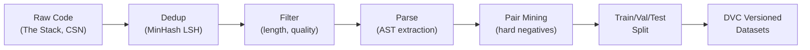
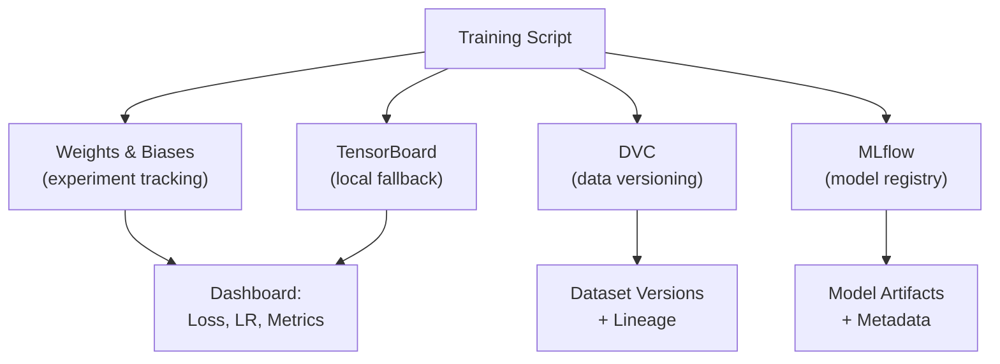

# 🐍 PyCodeEmbed: Small Python Code Embedding Model

## Project Overview

Train a lightweight embedding model specialized for Python code that produces high-quality vector representations for tasks like code search, clone detection, and semantic similarity. The model must run efficiently on a consumer laptop (≤8 GB RAM, no GPU required for inference).

---

## 1. Goals & Non-Goals

### Goals
- Train a **≤ 130M parameter** encoder model that produces 256–768 dim embeddings for Python code
- Achieve competitive scores on standard code retrieval benchmarks (CodeSearchNet Python, CoSQA)
- Full observability: experiment tracking, metric dashboards, data versioning
- Comprehensive evaluation suite with unit-level accuracy tests and regression gates
- Reproducible end-to-end pipeline runnable on a single machine (MacBook / Linux laptop with 16 GB RAM)

### Non-Goals
- Multi-language support (Python only for v1)
- Generative capabilities (embedding-only)
- Production serving infrastructure (inference is local-first)

---

## 2. Architecture

### 2.1 Base Model Selection

| Candidate | Params | Why |
|---|---|---|
| **`microsoft/codebert-base`** | 125M | Pre-trained on code, strong baseline |
| **`microsoft/unixcoder-base`** | 125M | Multi-modal code pre-training, SOTA on several benchmarks |
| **`Salesforce/codet5-small`** | 60M | Smaller, encoder-decoder (use encoder only) |
| **`BAAI/bge-small-en-v1.5`** | 33M | Tiny, excellent general embedding, fine-tune for code |

> [!IMPORTANT]
> **Recommended starting point**: `microsoft/unixcoder-base` (125M). It already understands code structure (AST, comments, docstrings) and is proven on code search. If size is paramount, fall back to `BAAI/bge-small-en-v1.5` (33M) with domain adaptation.

### 2.2 Embedding Head

```
┌─────────────────────────┐
│  Transformer Encoder    │  (frozen or fine-tuned)
│  (UniXcoder / CodeBERT) │
└──────────┬──────────────┘
           │ [CLS] token hidden state
           ▼
┌─────────────────────────┐
│  Projection MLP         │  Linear(768→512) → GELU → Linear(512→384)
│  (trainable)            │
└──────────┬──────────────┘
           │
           ▼
┌─────────────────────────┐
│  L2 Normalize           │  unit-sphere embeddings
└─────────────────────────┘
```

### 2.3 Pooling Strategy
- **Primary**: `[CLS]` token pooling (standard for bi-encoder)
- **Ablation**: Mean pooling over non-padding tokens (often better for sentence-transformers)
- Compare both in evaluation and pick the winner

### 2.4 Quantization & Optimization (for laptop inference)
- Export to ONNX with `optimum`
- INT8 dynamic quantization via ONNX Runtime
- Target: **< 200 MB model file**, **< 50 ms / snippet** on CPU

---

## 3. Data Pipeline

### 3.1 Datasets

| Dataset | Purpose | Size | Source |
|---|---|---|---|
| **CodeSearchNet (Python)** | Code ↔ NL search pairs | ~500K functions | HuggingFace `code_search_net` |
| **CoSQA** | Code search QA pairs | 20K | HuggingFace `code_x_glue_cc_code_search` |
| **The Stack (Python subset)** | Unsupervised pre-training data | Millions of files | HuggingFace `bigcode/the-stack-dedup` |
| **CodeContests (Python)** | Hard positive/negative mining | ~10K problems | HuggingFace |
| **Synthetic** | GPT-generated paraphrases for augmentation | ~50K | Self-generated |

### 3.2 Data Processing Pipeline



### 3.3 Data Quality Filters
- Remove files > 512 tokens (post-tokenization)
- Remove auto-generated code (detect via header heuristics)
- Remove near-duplicates (MinHash with Jaccard threshold 0.8)
- Require at least one function definition
- Require valid Python syntax (`ast.parse` check)
- Remove files with > 50% comments (likely tutorials/docs)

### 3.4 Hard Negative Mining
- **BM25 negatives**: For each query, retrieve top-50 BM25 results; negatives = high BM25 but semantically different
- **In-batch negatives**: Standard contrastive learning technique
- **Cross-epoch negative refresh**: Re-mine hard negatives every 2 epochs using the current model

---

## 4. Training Pipeline

### 4.1 Training Objectives

#### Stage 1: Contrastive Pre-training (unsupervised)
- **SimCSE-style** contrastive learning on The Stack Python subset
- Positive pairs via dropout augmentation (same input, different dropout masks)
- Temperature-scaled InfoNCE loss: τ = 0.05
- Duration: ~2 epochs over 500K samples

#### Stage 2: Supervised Fine-tuning
- **Multi-Negative Ranking Loss** (MNRL) on CodeSearchNet pairs
- Each batch: 1 positive + N in-batch negatives + K hard negatives
- Loss: `MultipleNegativesRankingLoss` from `sentence-transformers`
- Duration: 5–10 epochs with early stopping

#### Stage 3: Matryoshka Representation Learning (MRL)
- Train with multiple dimensionality targets: [64, 128, 256, 384]
- Enables flexible embedding dimensions at inference time
- Loss: weighted sum of contrastive losses at each dimension

### 4.2 Hyperparameters

```yaml
# config/train_config.yaml
model:
  base: "microsoft/unixcoder-base"
  max_seq_length: 512
  embedding_dim: 384
  pooling: "cls"  # or "mean"

training:
  stage1:
    learning_rate: 3e-5
    batch_size: 128  # effective, with gradient accumulation
    gradient_accumulation_steps: 8  # actual batch = 16 per step
    epochs: 2
    warmup_ratio: 0.1
    weight_decay: 0.01
    fp16: true
    scheduler: "cosine"

  stage2:
    learning_rate: 2e-5
    batch_size: 64
    gradient_accumulation_steps: 4
    epochs: 10
    warmup_ratio: 0.1
    weight_decay: 0.01
    fp16: true
    scheduler: "cosine_with_restarts"
    early_stopping_patience: 3

  stage3_mrl:
    dimensions: [64, 128, 256, 384]
    dimension_weights: [0.1, 0.2, 0.3, 0.4]
    epochs: 3
    learning_rate: 1e-5

hardware:
  device: "mps"  # Apple Silicon; or "cuda" / "cpu"
  num_workers: 4
  pin_memory: true
```

### 4.3 Training Best Practices Checklist

- [x] **Gradient accumulation** — simulate large batches on limited memory
- [x] **Mixed precision (FP16/BF16)** — 2x memory savings, faster training
- [x] **Cosine LR schedule with warm-up** — stable convergence
- [x] **Early stopping** — prevent overfitting with patience = 3
- [x] **Gradient clipping** — max_grad_norm = 1.0
- [x] **Weight decay** — AdamW with 0.01 decay (exclude bias & LayerNorm)
- [x] **Reproducibility** — fixed seeds, deterministic ops where possible
- [x] **Data shuffling** — per-epoch reshuffling with seed offset
- [x] **Hard negative mining** — refresh every 2 epochs
- [x] **Matryoshka training** — flexible dimensionality at inference
- [x] **Checkpoint saving** — save best + last + every N steps
- [x] **Evaluation during training** — eval every 500 steps

---

## 5. Evaluation & Accuracy Testing

### 5.1 Benchmark Suite

| Benchmark | Metric | What it measures |
|---|---|---|
| **CodeSearchNet Python** | MRR@10, NDCG@10 | NL → Code retrieval |
| **CoSQA** | MRR, Accuracy@1 | Code search QA |
| **Code Clone Detection (BCB-Python)** | F1, MAP | Semantic clone detection |
| **STS-B (sanity check)** | Spearman ρ | General embedding quality |
| **Custom Python Similarity** | Spearman ρ | Hand-labeled Python snippet pairs |

### 5.2 Retrieval Metrics (computed at each eval step)

```python
RETRIEVAL_METRICS = {
    "MRR@1":   "Mean Reciprocal Rank at 1",
    "MRR@5":   "Mean Reciprocal Rank at 5",
    "MRR@10":  "Mean Reciprocal Rank at 10",
    "Recall@1": "Recall at 1",
    "Recall@5": "Recall at 5",
    "Recall@10": "Recall at 10",
    "Recall@100": "Recall at 100",
    "NDCG@10":  "Normalized Discounted Cumulative Gain at 10",
    "MAP@10":   "Mean Average Precision at 10",
}
```

### 5.3 Embedding Quality Metrics

| Metric | Description |
|---|---|
| **Alignment** | Mean distance between positive pairs (lower is better) |
| **Uniformity** | Distribution uniformity on the hypersphere (lower is better) |
| **Isotropy** | Variance ratio of embedding dimensions (higher is better) |
| **Intrinsic Dimensionality** | Effective dimensionality via PCA explained variance |
| **Nearest Neighbor Overlap** | % of k-NN that are true positives |

### 5.4 Accuracy Test Suite (CI/CD Gates)

```python
# tests/test_embedding_quality.py

class TestEmbeddingQuality:
    """Hard gates — model cannot be promoted if these fail."""

    def test_mrr10_above_threshold(self):
        """MRR@10 on CodeSearchNet Python must be ≥ 0.65"""
        assert eval_results["csn_python"]["MRR@10"] >= 0.65

    def test_cosqa_accuracy_above_threshold(self):
        """Accuracy@1 on CoSQA must be ≥ 0.50"""
        assert eval_results["cosqa"]["Accuracy@1"] >= 0.50

    def test_embedding_not_degenerate(self):
        """Uniformity must be < -1.0 (not collapsed)"""
        assert eval_results["uniformity"] < -1.0

    def test_alignment_reasonable(self):
        """Alignment must be < 0.5 (positives are close)"""
        assert eval_results["alignment"] < 0.5

    def test_no_regression_vs_baseline(self):
        """Must not regress > 2% vs. last promoted model"""
        for metric in ["MRR@10", "Recall@10"]:
            assert eval_results[metric] >= baseline[metric] * 0.98

    def test_semantic_sanity(self):
        """Known similar pairs must have cosine > 0.8"""
        pairs = load_sanity_pairs()  # hand-curated
        for a, b, expected_similar in pairs:
            sim = cosine_similarity(embed(a), embed(b))
            if expected_similar:
                assert sim > 0.8
            else:
                assert sim < 0.3

    def test_inference_latency(self):
        """Single snippet embedding must take < 100ms on CPU"""
        assert benchmark_latency(model, device="cpu") < 0.1

    def test_model_size(self):
        """ONNX model must be < 250 MB"""
        assert os.path.getsize(onnx_path) < 250 * 1024 * 1024
```

### 5.5 Ablation Studies

Track each of these as separate experiment runs:

| Ablation | Variants |
|---|---|
| Pooling strategy | CLS vs Mean vs Max |
| Embedding dimension | 128 / 256 / 384 / 768 |
| Base model | UniXcoder vs CodeBERT vs BGE-small |
| Training stages | Stage 1 only / 1+2 / 1+2+3 |
| Hard negative strategy | None / BM25 / In-batch only / BM25 + In-batch |
| Data size | 25% / 50% / 100% |

---

## 6. Observability & Experiment Tracking

### 6.1 Tooling Stack



### 6.2 What to Log

#### Every Training Step
- `train/loss` — primary training loss
- `train/learning_rate` — current LR
- `train/grad_norm` — gradient norm (detect explosions)
- `train/gpu_mem_allocated` — memory usage
- `train/throughput_samples_sec` — training speed
- `train/epoch` — fractional epoch

#### Every Eval Step (every 500 training steps)
- All retrieval metrics from §5.2
- All embedding quality metrics from §5.3
- `eval/loss` — validation loss
- Embedding space visualizations (UMAP/t-SNE) logged as W&B media

#### Per Epoch
- Full benchmark suite results (§5.1)
- Confusion matrix for clone detection
- Retrieval examples: top-5 results for 10 fixed queries (qualitative)
- Histogram of cosine similarities (positive vs negative pairs)

#### Per Experiment
- Git commit hash
- Full config YAML
- Dataset version (DVC hash)
- Hardware info (CPU, RAM, GPU if any)
- Total training time
- Final model size (disk)

### 6.3 Alerts & Monitoring

| Alert | Condition | Action |
|---|---|---|
| **Loss spike** | loss > 3× rolling avg | Log warning, consider reducing LR |
| **Gradient explosion** | grad_norm > 10.0 | Clip and log warning |
| **Metric plateau** | No improvement for 3 evals | Trigger early stopping check |
| **OOM risk** | Memory > 90% | Reduce batch size dynamically |
| **NaN loss** | Any NaN in loss | Halt training, save debug checkpoint |

### 6.4 Dashboards

Create W&B dashboard panels for:
1. **Training Overview** — loss curves, LR schedule, throughput
2. **Retrieval Quality** — MRR/Recall/NDCG over time per benchmark
3. **Embedding Health** — alignment, uniformity, isotropy over time
4. **Ablation Comparison** — parallel coordinates plot across experiments
5. **Inference Benchmarks** — latency, model size, memory usage

---

## 7. Project Structure

```
pycode-embed/
├── configs/
│   ├── train_config.yaml          # Main training config
│   ├── eval_config.yaml           # Evaluation settings
│   └── sweep_config.yaml          # Hyperparameter sweep
│
├── src/
│   ├── __init__.py
│   ├── data/
│   │   ├── __init__.py
│   │   ├── dataset.py             # Dataset classes
│   │   ├── collator.py            # Data collation
│   │   ├── preprocessing.py       # Dedup, filter, parse
│   │   └── hard_negatives.py      # BM25 & mined negatives
│   │
│   ├── model/
│   │   ├── __init__.py
│   │   ├── encoder.py             # Bi-encoder wrapper
│   │   ├── pooling.py             # CLS / Mean / Max pooling
│   │   ├── projection.py          # MLP projection head
│   │   └── matryoshka.py          # MRL wrapper
│   │
│   ├── training/
│   │   ├── __init__.py
│   │   ├── trainer.py             # Custom Trainer class
│   │   ├── losses.py              # InfoNCE, MNRL, MRL losses
│   │   ├── callbacks.py           # Logging, early stopping, alerts
│   │   └── scheduler.py           # LR schedulers
│   │
│   ├── evaluation/
│   │   ├── __init__.py
│   │   ├── benchmarks.py          # Benchmark loaders
│   │   ├── retrieval_metrics.py   # MRR, Recall, NDCG, MAP
│   │   ├── embedding_metrics.py   # Alignment, uniformity, isotropy
│   │   ├── visualize.py           # UMAP, t-SNE, histograms
│   │   └── report.py              # Generate eval report
│   │
│   └── export/
│       ├── __init__.py
│       ├── onnx_export.py         # ONNX conversion
│       └── quantize.py            # INT8 quantization
│
├── scripts/
│   ├── download_data.py           # Download & cache datasets
│   ├── preprocess.py              # Run full preprocessing
│   ├── train.py                   # Main training entry point
│   ├── evaluate.py                # Standalone evaluation
│   ├── export.py                  # Export & quantize model
│   └── demo.py                    # Interactive demo
│
├── tests/
│   ├── test_embedding_quality.py  # Quality gates (§5.4)
│   ├── test_data_pipeline.py      # Data processing tests
│   ├── test_model.py              # Model forward pass tests
│   ├── test_metrics.py            # Metric computation tests
│   └── test_export.py             # ONNX export tests
│
├── notebooks/
│   ├── 01_data_exploration.ipynb
│   ├── 02_training_analysis.ipynb
│   └── 03_embedding_visualization.ipynb
│
├── docs/
│   └── plan.md                    # This document
│
├── .github/
│   └── workflows/
│       └── ci.yml                 # Run tests + quality gates on PR
│
├── dvc.yaml                       # DVC pipeline definition
├── pyproject.toml                 # Project metadata & dependencies (uv)
├── Makefile                       # Convenience commands
├── README.md
└── .env.example                   # W&B API key, etc.
```

---

## 8. Milestone Plan

### Phase 1: Foundation (Week 1–2)
- [ ] Set up project structure, linting, CI
- [ ] Download and preprocess CodeSearchNet Python
- [ ] Implement data pipeline (dedup, filter, parse)
- [ ] Implement base bi-encoder model with CLS pooling
- [ ] Set up W&B + DVC integration
- [ ] Write unit tests for data pipeline and model forward pass
- [ ] **Gate**: Data pipeline tests pass, model produces embeddings

### Phase 2: Training v1 (Week 3–4)
- [ ] Implement Stage 1 (SimCSE contrastive pre-training)
- [ ] Implement Stage 2 (Supervised fine-tuning with MNRL)
- [ ] Implement all retrieval metrics (MRR, Recall, NDCG, MAP)
- [ ] Implement embedding quality metrics (alignment, uniformity)
- [ ] Run first full training run with logging
- [ ] **Gate**: MRR@10 ≥ 0.50 on CodeSearchNet Python

### Phase 3: Optimization (Week 5–6)
- [ ] Implement hard negative mining (BM25 + cross-epoch refresh)
- [ ] Implement Stage 3 (Matryoshka Representation Learning)
- [ ] Run ablation studies (pooling, dim, base model, data size)
- [ ] Hyperparameter sweep via W&B Sweeps
- [ ] **Gate**: MRR@10 ≥ 0.65, all quality tests pass

### Phase 4: Export & Polish (Week 7–8)
- [ ] ONNX export + INT8 quantization
- [ ] Inference latency benchmarks
- [ ] Build interactive demo (CLI + optional Gradio)
- [ ] Write documentation and README
- [ ] Full evaluation report with all benchmarks
- [ ] Set up CI quality gates (GitHub Actions)
- [ ] **Gate**: Model < 250 MB, latency < 100 ms on CPU, all CI tests green

---

## 9. Risk Mitigation

| Risk | Likelihood | Impact | Mitigation |
|---|---|---|---|
| Training too slow on laptop | High | Medium | Use gradient accumulation, FP16, smaller batch; consider cloud burst for sweeps |
| Overfitting on small dataset | Medium | High | Dropout, weight decay, early stopping, data augmentation |
| Embedding collapse | Low | Critical | Monitor uniformity metric, use temperature tuning, add uniformity regularization |
| Memory OOM during training | High | Medium | Dynamic batch sizing, gradient checkpointing, offload to CPU |
| Poor generalization beyond CodeSearchNet | Medium | High | Evaluate on CoSQA + custom test set, diverse training data |

---

## 10. Success Criteria

| Criterion | Target |
|---|---|
| CodeSearchNet Python MRR@10 | ≥ 0.65 |
| CoSQA Accuracy@1 | ≥ 0.50 |
| Model size (ONNX, quantized) | < 250 MB |
| Inference latency (CPU, single snippet) | < 100 ms |
| All quality gate tests | ✅ Pass |
| Experiment tracking coverage | 100% of runs logged |
| Test coverage (unit + integration) | ≥ 80% |
